<picture>
  <source media="(prefers-color-scheme: dark)" srcset="assets/hero-darkroom.svg" />
  
</picture>

  <a href="https://kemalcalak.com"><picture><source media="(prefers-color-scheme: dark)" srcset="assets/link-website-darkroom.svg" /></picture></a>
  <a href="https://www.linkedin.com/in/alikemalcalak/"><picture><source media="(prefers-color-scheme: dark)" srcset="assets/link-linkedin-darkroom.svg" /></picture></a>
  <a href="https://medium.com/@kemalcalak"><picture><source media="(prefers-color-scheme: dark)" srcset="assets/link-medium-darkroom.svg" /></picture></a>
  <a href="mailto:kemalcalak@gmail.com"><picture><source media="(prefers-color-scheme: dark)" srcset="assets/link-email-darkroom.svg" /></picture></a>

Junior AI engineer building intelligent agents: multi-agent orchestration, MCP integration and workflow automation. The fullstack toolkit that turns them into products: FastAPI, Next.js, PostgreSQL. Latest writing: [backend security, on Medium](https://medium.com/p/688f6d61a4c6).

  <a href="https://github.com/kemalcalak/design-editor"><picture><source media="(prefers-color-scheme: dark)" srcset="assets/film-design-editor-darkroom.svg" /></picture></a>
  <a href="https://github.com/kemalcalak/warroom"><picture><source media="(prefers-color-scheme: dark)" srcset="assets/film-warroom-darkroom.svg" /></picture></a>
  <a href="https://github.com/kemalcalak/NextJS-Template"><picture><source media="(prefers-color-scheme: dark)" srcset="assets/film-nextjs-template-darkroom.svg" /></picture></a>
  <a href="https://github.com/kemalcalak/Fastapi-Template"><picture><source media="(prefers-color-scheme: dark)" srcset="assets/film-fastapi-template-darkroom.svg" /></picture></a>

<picture>
  <source media="(prefers-color-scheme: dark)" srcset="assets/credits-darkroom.svg" />
  
</picture>

  <picture>
    <source media="(prefers-color-scheme: dark)" srcset="https://github-readme-stats-ruddy-gamma-27.vercel.app/api?username=kemalcalak&show_icons=true&include_all_commits=true&locale=en&bg_color=0b0a09&title_color=eae3d6&text_color=b4aca4&icon_color=ff4a1c&ring_color=ff4a1c&hide_border=true&disable_animations=true" />
    
  </picture>
  <picture>
    <source media="(prefers-color-scheme: dark)" srcset="https://github-readme-stats-ruddy-gamma-27.vercel.app/api/top-langs?username=kemalcalak&langs_count=10&locale=en&layout=compact&bg_color=0b0a09&title_color=eae3d6&text_color=b4aca4&hide_border=true&disable_animations=true" />
    
  </picture>

<picture>
  <source media="(prefers-color-scheme: dark)" srcset="https://raw.githubusercontent.com/kemalcalak/kemalcalak/output/github-contribution-grid-snake-dark.svg" />
  
</picture>

<picture>
  <source media="(prefers-color-scheme: dark)" srcset="assets/closing-darkroom.svg" />
  
</picture>
